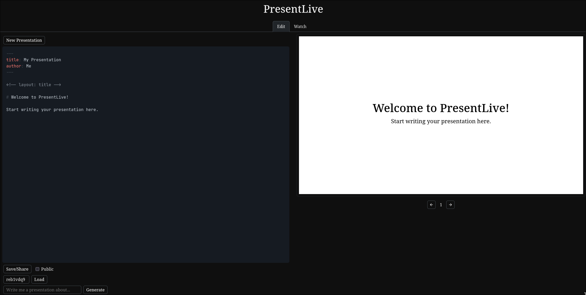

# PresentLive

PresentLive is an application that allows for editing and sharing of presentation decks written with
markdown.

```
npm i
npm run dev & npm run server
```

Firstly run `npm i` to install/update dependencies.

`npm run dev` runs the web application on `localhost`, the port of which will be displayed by
`stdout`.

`npm run server` runs the LLM communication server, which is necessary for using the AI assistant
feature.
This **must** be run from the root project directory to work as expected.

## AI Assistant Setup
The server handles cross-origin requests between the web app and the API's LLM interface.
The AI assistant will only work if the server is running on localhost, port `3001` (which it should
since this is hardcoded into the server).
The web app sends a POST request to the server, then the server sends a POST request to the LLM API.

The environment variable `AI_API_KEY` must be set to a valid API key.

## Editing PresentMD With Live Preview

Any features that use the API must have environment variable `VITE_API_KEY` set to a valid API key,
or the API will respond with a `401`.

### GUI Controls


- "New Presentation" resets the state of the editor, including the presentation code (see below),
  so that you are able to edit a new presentation without overwriting the one you were previously
  working on.
- "Save/Share" uploads the current presentation to the API.
  An alert will display with the unique presentation code, which can be loaded by yourself or a
  collaborator to continue working on the presentation.
    - If the "Public" checkbox is checked upon saving, then the presentation can be viewed by others
      using a public code, which will also be displayed in the alert.
      The public code is only usable in the "Watch" tab, which will not allow users to edit the
      presentation.
- "Load" loads the presentation corresponding to the provided code from the API into the editor.
- "Delete" deletes the current presentation from the API.
  This option will only be available if working on a presentation that was loaded from the API.
- "Generate" uses the AI assistant to generate a new presentation about the provided topic.
- The arrow icons below the preview window change the slide being shown in the preview.
  The current slide number is displayed between them.

### Workflow
1. Navigate to the "Edit" tab in the navbar at the top of the page (which is loaded by default).
2. Use the text area on the left to edit the contents of the slide with PresentMD, and notice that
   the preview on the right updates in real time.
3. Add a new slide by using a separator `---`, and write more contents below it.
   Now you can navigate between slides using the arrow buttons below the previewer.
4. Click "Save/Share" to save it to the API.
   Keep the code it shows you so that you can load it again later.
5. Click "New Presentation" to start fresh.
6. Type the presentation code from before into the text input that says "Code".
   Now click the "Load" button to restore the presentation that you had before.
7. Click the "Delete" button, then try to load the same presentation from before.
   Notice that it no longer exists.
8. Type a topic into the "Write me a presentation about..." text input and click "Generate".
   After it loads, the editor and preview will show an AI generated presentation about the provided
   topic.
9. Save the presentation after checking the "Public" box.
   There is now an additional public code.
   Save this for later to test the presentation watcher.

## Satisfaction of Functionality Requirements

### App Design and Navigation
- The application contains a consistent header.
- The application navigation is clear, with each nav tab displaying in text where it navigates to.
- Foreground elements have whitish outlines and text on top of a dark background so that they are
  visually distinguishable.
- All buttons have a text description or commonly recognised visual description (i.e. arrow icons)
  indicating their function.
- All text inputs have placeholder text describing what should be input.
- All actions that have possible failures trigger visual alerts upon their failure or success.

### A Multi-Entity Data Structure
- There are 3 related data entities:
  - `presentmd`: `{ code, contents }` to store presentations.
  - `public`: `{ public_code, private_code }` to associate public codes with presentations
    and their polls.
  - `poll`: `{ pollid, options, responses }` stores poll options and responses, related to a unique
    id (private presentation code appended with poll name).
- These data entities are all stored and retrieved via the RESTful API provided by the course.
- Records can be added, deleted, and edited using the GUI controls in the app.
- Text inputs are validated with alerts to display success or failure of inputs.
  Alerts use user-friendly, plain English messages while specific errors are logged in the console.

### Data Collection and Interaction
- All data collected is intended to be used again in the app.
  - Saved presentation -> loaded presentation
  - Public presentation -> presentation watcher
  - Poll submissions -> poll results menu
- Summary information derived from related data is displayed.
  - Poll results displayed as graphs and individual responses with names.
  - Number of participants/viewers as well as list of names.
- Data makes a round trip between user types.
  - A presentation editor can save their presentation, so that another editor can contribute to it.
  - When it is made public, viewers can watch the presentation and participate in polls.
  - Editors can look at poll results obtained from viewers' submissions.

### User Stories / Workflows
- Presentation editor
  - Creates and edits presentations, views poll results.
- Presentation viewer
  - Views presentations and participates in polls.
  - This workflow is a guided multi-step flow: viewers are prompted to enter their name, then
    advance through slides irreversably, answer polls as they appear, then a "presentation finished"
    message.

### Unique Link Access
- A unique presentation code is generated so that editors and their collaborators can access and
  edit an already initialised presentation.
- A unique public code is generated so that users can view the presentation.
- Authentication is not required for these accesses.

### AI Integration
- An AI assistant exists which can generate a presentation about a provided topic.
  It directly modifies the contents of the markdown input field.

### Advanced Features
- Export presentation to .fodp.
